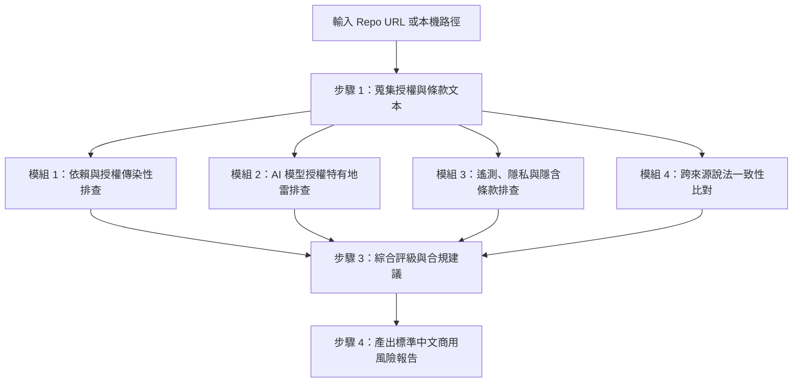

# 授權檢查器（License & Commercial Risk Checker）v1.1

本 Skill 旨在協助開發者、產品經理與架構師，在引入第三方開源專案、相依套件或開源 AI 模型前，進行**中文商用風險評估**與**授權地雷排查**。

---

## 誠實邊界與定位聲明（Honest Positioning）

> [!IMPORTANT]
> **本 Skill 的定位與差異化**：
> 1. **既有工具已能做的事**：免費工具（如 `license-checker`、`cargo-deny`、`pip-licenses`、`ScanCode Toolkit`、`FOSSA` / `Snyk` 免費版）已經能精確提取 SPDX 識別碼並列出相依套件授權清單。本 Skill **不是**「唯一能檢查授權的工具」，亦不重複發明輪子。
> 2. **本 Skill 專注的盲區（賣點）**：
>    - **中文白話商用風險判斷**：針對商業閉源專案、SaaS 架構提供具體合規建議。
>    - **限制型與源代碼可用協議排查**：PolyForm 家族防競爭條款、Sustainable Use License（Fair-code）限縮內部業務使用與工作流託管禁令（如 n8n 實案）。
>    - **AI 模型特有地雷排查**：代碼與權重授權脫鉤、研究專用（如 Qwen-Image-2.1）、地域排除（如 MiniMax H3 排除美歐英韓）、用戶規模門檻（如 Llama 3.1 700M MAU）、權重非商用但允許輸出物商用之分離授權（如 FLUX.1 [dev]）、禁止衍生訓練（Non-compete training）。
>    - **遙測與隱私條款坑（Default-On Telemetry）**：深入代碼層檢驗是否預設回傳數據（如 Next.js 實案）、網路端點追蹤、關閉環境變數與稽核模式。
>    - **多來源說法不一致（跨來源矛盾）**：逐項對比 README、LICENSE 檔、官網與模型卡描述，抓出自動化掃描工具只看 LICENSE 造成的假綠燈盲區（如 Diff-HMR 實案），堅持嚴格客觀並列，絕不自行猜測選邊。
> 3. **非法律意見免責聲明**：本 Skill 產出之報告為工程與商務評估參考，**不構成正式法律意見（Legal Advice）**。重大商業決策請諮詢合格智慧財產權律師。
> 4. **零瞎編承諾**：每項結論必須附有**可查驗的來源**（檔案路徑、官方連結與查核日期）；查無證據或無法核實的項目，一律標註為「**未核實**」，嚴禁臆測或編造條文。

---

## 輸入規格（Input Specification）

使用者可提供以下任一種輸入：
1. **公開 Repository 連結**：GitHub / GitLab / Hugging Face 倉庫 URL。
2. **本機專案路徑**：已 clone 或本機開發中的目錄路徑。
3. **指定目標與商業場景（可選）**：
   - 預計商業場景（例如：內部內部工具、SaaS 雲端服務、閉源客戶端軟體分發、SDK 嵌入等）。
   - 預計營運地區（例如：全球、台灣、美國、歐盟等）。

---

## 核查工作流程（Execution Workflow）



---

## 五大檢查模組與規則庫

### 模組 1：相依性與授權傳染性排查（Dependency & Copyleft Conflicts）

檢查專案根目錄授權及主要相依套件是否具有「傳染性（Copyleft）」或「非開源限制」：

1. **強傳染性開源協議（Strong Copyleft）—— 高風險（用於閉源/SaaS 時）**
   - **AGPL-3.0 / OSL-3.0**：
     - **規則**：透過網路提供服務（SaaS / API 調用）即被視為分發（Distribution），觸發必須公開完整後端原始碼之義務（如 AGPL 第 13 條）。
     - **真實案例**：`ivankovic/omnidiff`（作者 FabCH 刻意採用 AGPL 反制大廠吸納，提供付費商業授權）。
   - **GPL-2.0 / GPL-3.0**：
     - **規則**：若將專案打包編譯或靜態連結並分發（例如售賣軟體安裝包、發布 App），必須連同自身專案原始碼以 GPL 授權開源。
2. **弱傳染性協議（Weak Copyleft）—— 中/低風險**
   - **LGPL-2.1 / LGPL-3.0 / MPL-2.0 / EPL-2.0**：
     - **規則**：修改該套件本身需開源修改部分；若僅為動態連結（Dynamic Linking），主專案通常可維持閉源。
     - **排查重點**：語言特性（如 Go、Rust、C 靜態編譯是否造成整體被感染）。
3. **限制型與源代碼可用協議（Source-Available / Restricted Commercial）—— 高風險**
   - **PolyForm 家族（如 PolyForm Shield 1.0.0, PolyForm Noncommercial 1.0.0）**：
     - **規則**：PolyForm Shield 禁止開發與原作者「競爭（Competition）」的產品或服務（真實案例：`alchaincyf/huashu-bird-sticker` 早期版本）；PolyForm Noncommercial 則徹底禁止任何直接或間接收費的商業行為。
   - **Sustainable Use License / Fair-Code 模式（真實案例：`n8n-io/n8n`）**：
     - **規則**：授權在「Limitations」中明文規定**僅供自身內部業務目的（internal business purposes）或個人非商業用途**！
     - **商業禁止行為**：禁止將軟體包裝為雲端託管服務（Workflow-as-a-Service）銷售給外部用戶、禁止允許外部客戶登入自建流程、禁止以 White-label 形式嵌入對外銷售的商業 SaaS。
     - **三方機制深度對比**：
       | 授權類型 | OSI 認可開源？ | 允許做雲端 SaaS 販售？ | 核心機制與限制 |
       | :--- | :--- | :--- | :--- |
       | **AGPL-3.0** | **是** | **允許** | 透過網路提供服務觸發開源傳染（第 13 條），須提供後端完整原始碼。 |
       | **SSPL (MongoDB)** | 否（Source-Available） | **條件允許** | 允許 SaaS，但強制開源整個服務後台管理與基礎設施原始碼（Service Source Code）。 |
       | **Sustainable Use License** | 否（Fair-Code） | **直接禁止** | **直接從權利範圍限縮用途為「內部業務」**，無論是否開放源碼皆不可對外提供服務。 |
     - **企業代碼隔離條款（.ee 模式）**：包含 `.ee.` 或 `.ee` 目錄之代碼完全排除於該授權之外，需付費購買 Enterprise License。
   - **BSL 1.1 / Elastic License / Server Side Public License (SSPL)**：
     - **規則**：通常限制「將本軟體包裝為託管服務（Managed Service）提供給第三方」或設有過渡期。
4. **授權相容性衝突（License Incompatibility）—— 高/中風險**
   - 例如：Apache-2.0 與 GPL-2.0（因 Apache 2.0 專利條款與 GPLv2 第 6 條限制衝突，二者不相容，無法合併分發）。

---

### 模組 2：AI 模型授權特有地雷排查（AI Model License Traps）

若專案涉及 AI 模型權重（Model Weights）、微調腳本或推論 API，必須將「代碼授權」與「權重授權」分開檢視：

1. **研究專用授權（Research-Only / Non-Commercial）—— 高風險**
   - **規則**：代碼倉庫標示 Apache-2.0，但在 Hugging Face 或官方協議中採用「研究專用協議」，完全排除未經許可的商業部署。
   - **真實案例**：`Qwen/Qwen-Image-2.1`（Qwen Research License Agreement 明訂 Non-Commercial 為僅限學術研究與評估，商用需聯繫 `model-business@notice.qwencloud.com`）。
2. **地域排除條款（Geographic Exclusions）—— 極高風險（針對特定地區）**
   - **規則**：授權協議明文排除特定國家或司法管轄區的使用者，禁止在該區域內運行、分發或商業利用。
   - **真實案例**：`MiniMaxAI/MiniMax-H3`（MiniMax Community License 之 Applicable Territory 明文**排除美國、歐盟、英國與南韓**四國）。
3. **商業規模與用戶量/營收門檻限制（Revenue & Scale Thresholds）—— 中/高風險**
   - **規則**：免費商用設有上限，超過特定指標需向原廠取得額外書面授權或付費。
   - **三方門檻矩陣對照**：
     - **Meta Llama Community License（真實案例：`meta-llama/Llama-3.1-8B`）**：
       - **7 億 MAU 門檻（Section 2）**：若在版本發布日，被授權人及其關聯企業在前一曆月產品/服務 MAU 超過 7 億（700 million），必須向 Meta 申請獨立授權。
       - **AUP 強制合規（Section 1.b.iv）**：納入 Acceptable Use Policy，嚴禁軍事、危險武器、未授權醫療/法律專業諮詢、生成未成年人不當內容等。
       - **再分發與命名規範（Section 1.b.i & 1.b.iii）**：產品必須顯著標示「Built with Llama」、附帶 Notice 檔案；若使用輸出（Outputs）訓練/改進其他發布之模型，模型名稱**開頭必須包含 "Llama"**。
       - **專利反制與單方反向賠償（Section 5.c）**：提告智財訴訟即終止授權，使用者須為自身使用行為賠償 Meta。
     - **MiniMax H3 系列**：年營收超過 **2,000 萬美元**需事先取得書面授權（聯繫 `api@minimax.io`，主旨「MiniMax H3 licensing - authorization request」）；且具備美歐英韓地域排除。
     - **Qwen 系列**：商業開源模型（Qwen 2 / 2.5）設有 **1 億 MAU** 門檻（聯繫 `model-business@notice.qwencloud.com`）；特定檢查點（如 Qwen-Image-2.1）為研究專用。
4. **模型權重與輸出物商用權限分離（Weights vs. Outputs Disconnection）—— 中/高風險（真實案例：`black-forest-labs/FLUX.1-dev`）**
   - **規則**：模型權重本身的非商用限制，**不一定**延伸至模型產生物（Outputs）！必須精確剖析協議中關於 Outputs 的獨立條款。
   - **FLUX.1 家族授權三階架構**：
     - `FLUX.1 [schnell]`：Apache-2.0，開放權重，完全允許商業自建與部署。
     - `FLUX.1 [dev]`：Non-Commercial License v1.1.1，開放權重但**嚴禁商業部署與提供生圖服務**（需採購 BFL 商業授權）。
     - `FLUX.1 [pro]`：閉源旗艦模型，僅限付費 API（`docs.bfl.ai`）。
   - **輸出物商用放行與禁令（Section 2.d Outputs）**：
     - **商用放行**：原廠對 Outputs 不主張所有權，明文**允許將 Output 用於任何目的（包括商業目的，如商業插圖、廣告、遊戲美術）**。
     - **競品模型蒸餾禁令**：**嚴禁使用 Output 訓練、微調或蒸餾任何與 FLUX.1 競爭的模型**。
     - **附加義務**：強制要求實施內容過濾審查（Content Filters）與 AI 生成揭露；使用者承擔反向賠償條款（Section 7）。

---

### 模組 3：遙測、隱私與隱含條款排查（Telemetry & Hidden Clauses）

排查軟體在運行時是否存在隱私侵權、資安外洩或法律條款陷阱：

1. **預設開啟的遙測（Default-On Telemetry）與資料回傳（Phoning Home）—— 中風險（真實案例：`vercel/next.js`）**
   - **代碼層預設狀態判定**：
     - 排查配置讀取邏輯（如 Next.js `packages/next/src/telemetry/storage.ts` 中 `this.preferencesConf.get(TELEMETRY_KEY_ENABLED, true) === false`，預設為 `true` 即 Default-On）。
   - **網路回傳端點追蹤**：
     - 檢查代碼中硬編碼之遠端傳輸 URL（如 Next.js 向 `https://telemetry.nextjs.org/api/v1/record` POST 數據）。
   - **收集範圍安全審查**：
     - 判定回傳內容屬於匿名統計（CPU 核心、作業系統、構建耗時、套件使用）或敏感資料（環境變數、程式碼片段、Prompts、PII）。
   - **關閉開關與稽核機制**：
     - 檢查是否有標準環境變數（如 `NEXT_TELEMETRY_DISABLED=1`、`DO_NOT_TRACK=1`）、CLI 指令（`npx next telemetry disable`）、狀態查詢（`telemetry status`）或終端本地除錯模式（如 `NEXT_TELEMETRY_DEBUG=1` 輸出至 stderr）。
2. **資料所有權與反向授權條款（Data Ownership & Feedback License）—— 高風險**
   - **規則**：服務條款（Terms of Service）中是否規定「使用者透過本軟體處理的資料或輸入內容，視為授權原廠免費、全球、不可撤銷地使用或用於訓練後續模型」。
3. **免責聲明與單方反向賠償條款（Reverse Indemnification）—— 中/高風險**
   - **規則**：除了標準開源「現狀提供（AS IS）」外，是否要求使用者在遭受第三方智財侵權訴訟時，必須反向賠償原作者（如 Llama 3.1 Section 5.c、FLUX.1 [dev] Section 7）。

---

### 模組 4：跨來源說法一致性比對（Cross-Source Inconsistency）

開源專案常因維護者疏忽或商業模式調整，導致不同發布管道的授權宣告矛盾：

1. **比對四方資訊來源**：
   - 來源 A：專案根目錄 `LICENSE` / `COPYING` 檔案。
   - 來源 B：`README.md` 的 Badge 標章與文字說明。
   - 來源 C：套件管理器（npm / PyPI / Cargo）與平台元數據（GitHub API）。
   - 來源 D：官方網站、Hugging Face Model Card 或 Issue 討論串。
2. **揭露傳統自動化工具盲區（真實案例：`hanbyel0105/Diff-HMR`）**：
   - **盲區實況**：專案根目錄 `LICENSE` 存放 MIT 協議，但 `README.md` 授權章節明文標示 `"This work is licensed under CC BY-NC. See LICENSE for details."`。
   - **工具失效**：GitHub 官方 Licensee 掃描器與常規 SCA 工具（如 `license-checker`）僅讀取根目錄 `LICENSE` 檔案，導致系統給出 MIT 綠燈。商業團隊若直接採納，將面臨違反作者 CC BY-NC 宣告之侵權風險。
3. **判定與處置原則**：
   - **嚴格不選邊**：若 README 寫「CC BY-NC」但 LICENSE 檔案放「MIT」，**絕對不可自行替使用者決定哪一個才有效**。
   - **揭露法律模糊性與因應行動**：並列雙方原文，在作者透過 Git Commit 正式修訂前視為高風險，建議企業暫停引入或向作者開立 Issue 釐清。

---

## 報告輸出標準格式（Output Template）

產出報告必須嚴格遵循以下結構，使用清晰繁體中文呈現：

```markdown
# [專案名稱] 商用授權風險與條款合規報告

- **受檢專案**：[Repo URL 或路徑]
- **查核日期**：[YYYY-MM-DD]
- **查核依據版本**：[Commit Hash 或 Release Tag]
- **標稱主要授權**：[例如：AGPL-3.0-only / Apache-2.0 / 雙重授權]

---

## 1. 綜合風險評級與摘要

- **商用風險等級**：【🔴 高風險 / 🟡 中風險 / 🟢 低風險 / ⚪ 需進一步核實】
- **核心結論白話解說**：
  [用 2–3 句話直接說明在商業/SaaS/閉源情境下能否使用，主要阻礙是什麼]

---

## 2. 逐項檢查結論（Itemized Findings）

> 每項結論格式：【風險等級】+【白話說明】+【確切來源與查核日期】+【因應建議】

### 項次 1：相依性與授權傳染性排查
- **風險等級**：[高 / 中 / 低 / 未核實]
- **結論說明**：[白話描述]
- **核查來源**：[檔案路徑或 URL，附查核日期]
- **處置建議**：[隔離、替換套件、採用動態連結、或購買商業授權]

### 項次 2：AI 模型與權重授權排查
- **風險等級**：[高 / 中 / 低 / 未核實 / 不適用]
- **結論說明**：[代碼與權重授權差異、研究限制、地域排除、MAU門檻、輸出物商用放行與禁令]
- **核查來源**：[Model Card URL 或條文連結，附查核日期]
- **處置建議**：[商用授權申請、更換替代模型、設定地理圍欄]

### 項次 3：遙測、隱私與隱含條款排查
- **風險等級**：[高 / 中 / 低 / 未核實]
- **結論說明**：[預設遙測狀況、回傳端點、關閉方式、反向賠償條款]
- **核查來源**：[代碼行數或設定檔路徑，附查核日期]
- **處置建議**：[設定環境變數關閉、防火牆封鎖端點]

### 項次 4：跨來源授權說法一致性排查
- **風險等級**：[高 / 中 / 低 / 未核實]
- **差異對比**：
  - README 標示：[...]
  - LICENSE 檔案：[...]
  - 官方網站/Model Card：[...]
- **核查來源**：[各來源連結，附查核日期]
- **處置建議**：[避免選邊，建檔存證或向作者發起 Issue 釐清]

---

## 3. 未核實項目清單（Unverified Items）

[條列因原始碼未公開、外部連結失效或缺少條款文本而無法 100% 證實之項目。嚴格禁止編造！]
- 項目 A：[原因]
- 項目 B：[原因]

---

## 4. 免責聲明
本報告由授權檢查器（License & Commercial Risk Checker）依據公開代碼與條款文本自動彙整，僅供技術架構規劃與商業風險評估參考，不構成正式法律諮詢意見。若涉及訴訟防禦或重大商業合約，請洽專業法律顧問。
```

---

## 操作指令範例（Usage Example）

在 Claude Code / Codex / CLI 中調用：

```bash
# 針對遠端 repo 執行全面檢查
/license-risk-checker https://github.com/ivankovic/omnidiff

# 針對工作流專案排查 Sustainable Use License
/license-risk-checker https://github.com/n8n-io/n8n

# 針對前端框架排查 Default-On Telemetry
/license-risk-checker https://github.com/vercel/next.js

# 針對 AI 模型 repo 執行檢查
/license-risk-checker https://huggingface.co/MiniMaxAI/MiniMax-H3
/license-risk-checker https://huggingface.co/meta-llama/Llama-3.1-8B
/license-risk-checker https://huggingface.co/black-forest-labs/FLUX.1-dev

# 針對跨來源矛盾專案執行比對
/license-risk-checker https://github.com/hanbyel0105/Diff-HMR
```
